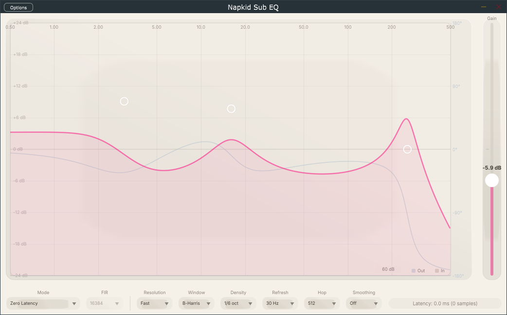

# Napkid Sub EQ

> English translation of README.md.

A graphical parametric equalizer VST3 audio plugin built for sub-bass, precisely controlling the **0.5 Hz – 500 Hz** band.

---

## Overview

Napkid Sub EQ is a parametric equalizer plugin designed specifically for low-frequency signal processing. Unlike the full-range EQs common on the market, it focuses on the core low-frequency range of **0.5 Hz to 500 Hz** and uses a **double-precision IIR biquad** filter architecture, ensuring precise coefficient calculation and a stable filter response even at extremely low frequencies.

It is particularly well suited to:
- Sub-bass sound design
- Low-frequency measurement and calibration
- An EQ module in low-frequency dynamics processing chains
- Frequency-response shaping of DC / unipolar control signals

---

## Interface Preview



---

## Features

- **8-node parametric EQ**: each node independently controls frequency, gain, Q and filter type
- **8 filter types**: Bell, High Pass, Low Pass, Low Shelf, High Shelf, Notch, Tilt, Band Pass
- **±24 dB gain range**: covers extreme gain requirements
- **Double-precision IIR biquad**: Direct Form II Transposed topology, numerically stable
- **Three global processing modes** (new in v0.2.0):
  - **Zero Latency**: pure IIR architecture, no additional processing latency
  - **Linear Phase**: a strictly linear-phase FIR designed from the IIR magnitude response; fixed latency (N-1)/2 + 511-sample block latency
  - **Minimum Phase**: a minimum-phase FIR designed from the IIR magnitude response via the cepstral method (causal FIR, group delay 0); latency is the 511-sample block latency
- **Selectable FIR length** (new in v0.3.0): 4096 / 16384 / 65536 points (Linear / Minimum Phase modes). A longer FIR improves low-frequency accuracy (65536 points @48 kHz gives ~0.37 Hz resolution) at the cost of more latency and CPU
- **FFT overlap-add convolution** (v0.3.0): in-house double-precision radix-2 FFT (lookup-table-optimised twiddles) for efficient, high-accuracy FIR processing
- **Automatic delay compensation (PDC)**: reports latency to the host whenever the mode or parameters change, supporting DAW plugin delay compensation
- **Real-time latency display**: the bottom panel shows the current mode's latency in ms / samples
- **Real-time phase response curve**: displayed in all three processing modes, synchronised with the magnitude curve. In Zero Latency mode it is the IIR phase; in Minimum Phase and Linear Phase modes it is the **excess phase** with the FIR bulk (group) delay removed — i.e. the phase deviation left by the FIR's pure delay. Linear Phase therefore reads approximately flat at 0°. The curve refreshes automatically once a new FIR design is published
- **Real-time spectrum analysis (multi-rate VQT engine since v0.4.0)**: dual input/output spectrum curves, independently estimated over the full ten-octave range from 0.5 to 500 Hz (the old FFT engine faked bins by interpolation below ~6 Hz); 1/6- or 1/12-octave density, three resolution tiers, four analysis windows (Hann/Blackman/B-Harris/Nuttall) and 15/30/60 Hz refresh rate are all selectable
- **Spectrum display smoothing (v0.4.1)**: frequency-domain inter-band smoothing (power-domain Hann-weighted kernel; Off / 1/6 / 1/3 / 2/3 octave, default 1/6); the time envelope runs in the power domain and is normalised by each analysis tier's true interval — a uniform ~180 dB/s fall rate across the whole band, fixing the slow release tail at the bottom of the spectrum
- **Convenient interaction**: click to create, drag to move, right-click to delete, scroll wheel to adjust Q (drag vertically to adjust Q for HP/LP/Notch/BP)
- **Double-click reset**: Bell/Shelf/Tilt reset gain and Q to zero on double-click; HP/LP/Notch/BP only reset Q
- **ASIO support**: low-latency audio interface compatibility

---

## Technical Specifications

| Parameter | Specification |
|-----------|---------------|
| Frequency range | 0.5 Hz – 500 Hz |
| Gain range | -24 dB – +24 dB |
| Q range | 0.1 – 10.0 |
| Number of nodes | 8 (independently switchable) |
| Number of parameters | 50 (8 nodes × 5 + master gain, bypass, EQ mode, FIR length and 6 spectrum parameters) |
| Filter precision | double (64-bit) |
| Spectrum resolution | 1/6 octave (61 bands, default) or 1/12 octave (121 bands) |
| Spectrum analysis engine | Multi-rate VQT filter bank (10 octave layers, frame length capped at 2 s) |
| Spectrum resolution tier | Fast / Balanced / Fine (kernel-length scale 0.7/1.0/1.5, default Balanced) |
| Spectrum analysis window | Hann / Blackman / B-Harris / Nuttall (default B-Harris, -92 dB sidelobes) |
| Spectrum update rate | 15 / 30 / 60 Hz selectable (default 30 Hz) |
| Spectrum analysis hop | 512 / 1024 / 2048 samples (default 512; top-tier stride, all tiers locked in step in real time) |
| Spectrum smoothing | Off / 1/6 / 1/3 / 2/3 oct (default 1/6, power-domain inter-band smoothing) |
| FIR length | 4096 / 16384 / 65536 points (selectable in Linear / Minimum Phase modes) |
| Processing modes | Zero Latency / Linear Phase / Minimum Phase |
| Processing latency | 0 – 32767 + 511-sample block latency (depending on mode and FIR length) |
| Supported formats | VST3, Standalone |
| Window size | 1040 × 620 pixels |
| Recommended minimum sample rate | 44100 Hz (soft specification statement; no code-enforced lower bound) |

---

## System Requirements

- **Operating system**: Windows 10/11 (64-bit)
- **DAW**: any VST3-compatible host
- **Compiler**: Visual Studio 2022 or newer (the Projucer export targets VS2022)
- **Dependency**: JUCE 7.x framework
- **Optional**: ASIO SDK (for ASIO support in the standalone build)

---

## Build Instructions

### Prerequisites

1. Install [JUCE](https://juce.com/) (7.x recommended)
2. Install Visual Studio 2022 (with the Desktop development with C++ workload)
3. (Optional) Download the [Steinberg ASIO SDK](https://www.steinberg.net/developers/) and place it on the project's reference path

### Build Steps

1. Open `Napkid Sub EQ.jucer` in Projucer
2. Make sure the module paths point to your JUCE modules directory
3. Click **File → Save Project and Open in IDE**
4. Select the **Release x64** configuration in Visual Studio
5. Click **Build → Build Solution**

After the build completes, the VST3 plugin is located at:
```
Builds/VisualStudio2022/x64/Release/VST3/
```

The standalone executable is located at:
```
Builds/VisualStudio2022/x64/Release/Standalone Plugin/
```

---

## Usage Guide

### Creating and Editing Nodes

| Action | Description |
|--------|-------------|
| Left-click on an empty area | Create a new node at the click position |
| Left-drag a node | Adjust frequency and gain (Bell/Shelf/Tilt) or frequency and Q (HP/LP/Notch/BP) |
| Right-click a node | Delete the node |
| Scroll wheel (over a node) | Adjust the Q value |
| Double-click a node | Reset gain to 0 dB and Q to 0.707 (HP/LP/Notch/BP reset Q only) |
| Shift + drag | Adjust frequency only |
| Ctrl + drag | Adjust gain only (Bell/Shelf/Tilt) or Q only (HP/LP/Notch/BP) |

### Switching Processing Modes

The bottom panel provides the processing mode selector:
- **Zero Latency**: pure IIR processing, zero latency — good for live performance and monitoring
- **Linear Phase**: strictly linear-phase FIR, fixed latency (N-1)/2 + 511-sample block latency, zero phase distortion — good for mastering
- **Minimum Phase**: minimum-phase FIR (causal design, group delay 0), latency only the 511-sample block latency, no pre-ringing — good for general mixing

The **FIR Length** selector (4096 / 16384 / 65536) in the bottom panel applies in both FIR modes: a longer FIR improves low-frequency accuracy (65536 points @48 kHz gives ~0.37 Hz frequency resolution, close to a full 0.5 Hz cycle) but increases latency and CPU usage accordingly. When switching, the plugin automatically reports the latency to the host (PDC). The bottom panel also provides the spectrum display parameter selectors (resolution / window / band density / refresh rate / analysis hop / smoothing; since v0.4.1 the spectrum group has six columns).

Switching modes automatically reports latency to the host, ensuring that the DAW's delay compensation (PDC) works correctly.

### Node Parameter Labels

Selecting a node shows a floating parameter label; click it to edit:
- **F (Freq)**: frequency value
- **G (Gain)**: gain value
- **Q**: Q value
- **T (Type)**: filter type (opens a popup menu to select)

### Master Gain Control

The right-hand panel is the master gain fader, supporting:
- Vertical dragging to adjust the total output gain (-24 dB – +24 dB)
- Double-clicking the fader to reset the gain to zero

---

## Project Structure

```
Sub EQ/
├── Source/
│   ├── PluginProcessor.h/.cpp       # main plugin processor
│   ├── PluginEditor.h/.cpp          # plugin editor entry point
│   ├── SubEQ_Core.h/.cpp            # double-precision biquad EQ engine
│   ├── SubEQ_DSPMath.h              # shared DSP math (templated FFT/IDFT, nextPow2, convolutionFftSize)
│   ├── SubEQ_FFTProcessor.h/.cpp    # FIR coefficient design and overlap-add convolution (Linear / Minimum Phase)
│   ├── SubEQ_Parameters.h           # APVTS parameter definitions
│   ├── SubEQ_Spectrum.h/.cpp        # real-time spectrum analyzer (multi-rate VQT core)
│   ├── SubEQ_Biquad.h               # double-precision biquad coefficients/state/frequency response (shared pure computation, no JUCE)
│   ├── SubEQ_BiquadDesign.h         # RBJ coefficient design (shared pure computation, no JUCE)
│   ├── SubEQ_FIRDesign.h            # linear/minimum-phase FIR design (shared pure computation, no JUCE)
│   ├── SubEQ_FFTConvolver.h         # overlap-add convolution primitives (shared pure computation, no JUCE)
│   ├── SubEQ_SpectrumMath.h         # octave band centre frequencies (shared pure computation)
│   ├── SubEQ_SpectrumConfig.h       # spectrum choice index → semantic value decoding (shared pure computation)
│   ├── SubEQ_WindowFunctions.h      # window function family coefficients/ENBW/sidelobes (shared pure computation)
│   ├── SubEQ_VQTDesign.h            # VQT tier structure/frame length/matched kernel/decimation chain (shared pure computation)
│   ├── SubEQ_CoordinateMapper.h     # response plot coordinate mapping (shared pure computation)
│   ├── SubEQ_NodeInteraction.h      # gain-sensitive types/type-switch reset/logarithmic Q stepping (shared pure computation)
│   ├── SubEQ_Spring.h               # second-order spring integrator (shared pure computation)
│   ├── SubEQ_FilterType.h           # FilterType enum + int↔enum mapping (shared pure computation)
│   └── SubEQ_Editor/
│       ├── SubEQLookAndFeel.h       # window/node/grid layout constants (legacy colours removed)
│       ├── FrequencyResponse.h/.cpp # response curve drawing and node interaction
│       ├── MasterGainSlider.h/.cpp  # master gain fader
│       ├── ModeSelector.h/.cpp      # bottom mode-selection panel (new in v0.2.0)
│       └── DesignSystem/            # liquid-glass design system (colours/fonts/animation/glass effects/LookAndFeel)
│   └── Fonts/                       # embedded fonts (Avenir.ttf, compiled into BinaryData via the jucer resources)
├── Builds/VisualStudio2022/         # VS project output directory (gitignored)
├── Napkid Sub EQ.jucer              # Projucer project file
└── README.md                        # Chinese README (this file is its English translation, README.en.md)
```

---

## Related Documentation

- **[Changelog](CHANGELOG.md)** — see the change history for every version
- **[Architecture Design Document](Documentation/SubEQ_Architecture_Design.md)** — an in-depth look at the DSP architecture, GUI design and key implementation decisions

---

## Key Technical Decisions

### Why double precision?

For a 0.5 Hz filter the normalised frequency is about 1.04×10⁻⁵ (@ 48 kHz). At float precision, trigonometric calculations and some coefficients can deviate significantly due to rounding errors, causing:
- the frequency response to deviate from the design value
- IIR poles to move close to or beyond the unit circle (instability)

Double precision (64-bit) provides about 15 decimal digits of precision, enough to handle these extreme coefficients safely.

### Design Considerations for the Three Processing Modes

| Mode | Latency | Phase characteristics | Use cases |
|------|---------|-----------------------|-----------|
| **Zero Latency** | 0 samples | Minimum phase (intrinsic to IIR) | Live performance, monitoring, low-latency requirements |
| **Linear Phase** | (N-1)/2 + 511 samples | Strictly linear phase | Mastering, phase-sensitive operations |
| **Minimum Phase** | 511 samples (causal FIR, group delay 0) | Minimum phase (FIR design) | Mixing, avoiding pre-ringing |

- **Linear Phase** uses frequency-domain sampling + IDFT to design symmetric FIR coefficients, guaranteeing strictly linear phase at the cost of fixed latency and pre-ringing
- **Minimum Phase** uses the cepstral method to derive a minimum-phase FIR from the magnitude response (causal design, group delay 0), with no pre-ringing
- Both FIR modes are designed from the current IIR magnitude response, ensuring magnitude-response consistency; the FIR length (4096 / 16384 / 65536) is selectable, and there is an additional 511-sample overlap-add block processing latency
- The phase curve is shown in all modes: Zero Latency plots the IIR phase, while the two FIR modes plot the excess phase after removing the FIR bulk (group) delay, so Linear Phase appears approximately flat at 0°

### Why Start at 0.5 Hz?

One of the design goals of this plugin is processing near-DC control signals. At a 48 kHz sample rate, one full cycle of a 0.5 Hz signal spans about 96,000 samples (2 seconds), providing ample data to model extremely low-frequency behaviour precisely.

---

## Known Limitations

- **GUI is Windows-only**: currently uses the Projucer VS2022 export target
- **Display wobble in the extreme low-frequency spectrum (0.5–1 Hz)**: since v0.4.0 the VQT engine restores full octave resolution above roughly 4–16 Hz (depending on window/resolution tier); with the 2 s analysis window cap, the 0.5 Hz band contains less than one full cycle within the window, so readings exhibit a slow ±2–3 dB phase wobble (a physical constraint; image rejection has been added to mitigate it; since v0.4.1 the power-domain envelope honestly follows each frame's reading, and the wobble appears as a slow ~6 Hz undulation). See `Documentation/SubEQ_VQT_Feasibility.md` §8
- **Spectrum noise-floor definition**: VQT band energy is aggregated by window ENBW × tier bandwidth (2× steps between tiers), so the noise-floor shape differs from the old "single-bin sampling" — it is flatter (constant bandwidth ratio per octave), which is expected behaviour
- **Relatively high spectrum CPU at 44.1 kHz**: the power-of-two decimation divisibility constraint makes the top-tier oversampling ratio high (about 2× that at 48 kHz), bringing the cost back to the order of the old engine; 48/96/192 kHz are unaffected
- **Peak broadening from spectrum smoothing (v0.4.1)**: inter-band smoothing tames noise fluctuation but broadens isolated pure-tone peaks — in the worst case (an isolated high-frequency tone) about -4.8 dB at 1/6, -7.0 dB at 1/3 and -9.5 dB at 2/3; the low-frequency range loses significantly less because its analysis kernel already overlaps bands. Choose Off when precise per-band readings are needed
- **Low-frequency accuracy vs latency trade-off in FIR modes**: the FIR length is selectable (4096 / 16384 / 65536 points); 4096 points @48 kHz gives ~11.7 Hz frequency resolution, so the response below 10 Hz is an interpolated approximation; 65536 points gives ~0.37 Hz resolution, but Linear Phase latency reaches 1.37 s and CPU usage is high. FIR modes also add 511 samples (~10.6 ms @48 kHz) of overlap-add block processing latency

---

## Dependencies and Licenses

This project is built on the following third-party technology stack. The license information for each component is as follows:

### Core Framework

- **[JUCE](https://juce.com/)**
  - Copyright (c) 2020–2025 Raw Material Software Limited
  - This project uses JUCE's **GPL v3** licensing option
  - The project as a whole is therefore released under the **GNU General Public License v3**
  - The full license text is in the [LICENSE](LICENSE) file

### Plugin Technology

- **VST3**
  - Copyright (c) Steinberg Media Technologies GmbH
  - VST3 SDK: [Apache License 2.0](https://github.com/steinbergmedia/vst3sdk)
  - Official website: https://www.steinberg.net/vst3

- **ASIO** (optional; only the standalone build needs ASIO support)
  - Copyright (c) Steinberg Media Technologies GmbH
  - Proprietary license: ASIO SDK License Agreement
  - Official website: https://www.steinberg.net/developers/

> **Note**: When distributing the VST3 version of this project, you do not need to distribute the VST3 SDK separately; compliance with GPL v3 is sufficient. If ASIO support is enabled in the standalone build, make sure you have read and agreed to Steinberg's ASIO SDK terms of use before distributing it.

---

## Author

**Napkid Audio**

---

## License

This project is released under the **GNU General Public License v3**. See the [LICENSE](LICENSE) file for details.
